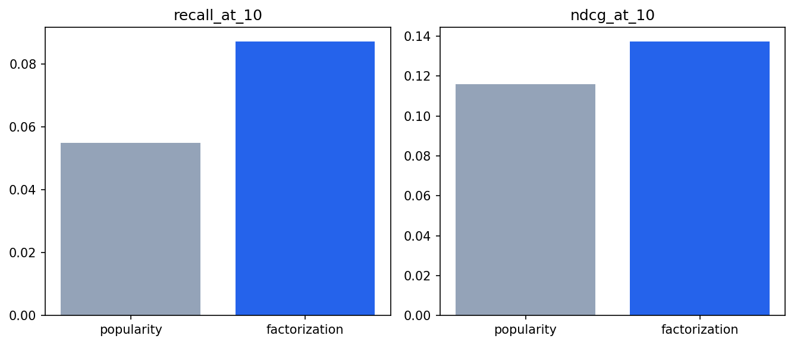
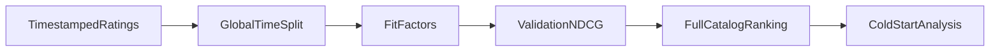

<p align="center"></p>

# MovieLens Recommender

**Personalization measured against a strong popularity baseline.**

[](https://github.com/Djordje3002/movielens-recommender/actions/workflows/ci.yml)


Rank unseen movies from historical user ratings and measure whether personalized collaborative filtering adds value over popular titles. The project implements regularized biased matrix factorization directly, then evaluates both rating error and full-catalog recommendation quality.

**Project 4/6 · Advanced** in the [Machine Learning Portfolio](https://github.com/Djordje3002/ml-portfolio).

## What this project demonstrates

matrix factorization · analytical gradients · temporal splits · NDCG · cold-start fallback.

Working training and prediction commands, real benchmark data, baseline comparisons, committed measured reports, an experiment-review notebook, regression tests and CI. This is a reproducible portfolio experiment; results describe the stated benchmark protocol.

## Measured results

| Model | recall at 10 | ndcg at 10 | catalog coverage at 10 |
| --- | ---: | ---: | ---: |
| `popularity` | 0.0550 | 0.1160 | 0.0470 |
| `factorization` | 0.0872 | 0.1374 | 0.1027 |

**Warm user-item rating prediction:**

| Model | mae | rmse | r2 |
| --- | ---: | ---: | ---: |
| `global_mean_baseline` | 1.0414 | 1.1951 | -0.0321 |
| `factorization` | 0.8070 | 0.9997 | 0.2779 |

**All eligible users, including cold-start popularity fallback:**

| Model | recall at 10 | ndcg at 10 | catalog coverage at 10 |
| --- | ---: | ---: | ---: |
| `popularity` | 0.0790 | 0.2268 | 0.0470 |
| `factorization` | 0.0904 | 0.2344 | 0.1095 |


**Selected using training CV or validation:** `popularity`. The tables report test results; selection is never changed to favor the test winner.

Popularity wins validation NDCG and remains the selected inference strategy, even though factorization has higher test NDCG on warm users. The global split produces substantial cold start: only 1,344 of 10,000 test ratings involve warm users and known items. Warm ranking covers 52 users; the additional all-user report covers 147 eligible users and uses popularity for unseen users. The optimizer hits its 100-iteration cap; the report explicitly records that it did not declare convergence.



Full precision, split counts, package versions and source provenance are in [metrics.json](reports/metrics.json). The committed run used Python 3.11 on macOS with seed 42. Results can vary slightly across platforms and dependency versions. These numbers are benchmark measurements, not production performance promises.

## Run locally

Use Python 3.11 or 3.12 and run commands from the repository root. No API key, paid service or GPU is required. The first training run downloads the small source archive; subsequent runs verify and reuse the local cache. The digits project uses scikit-learn's bundled dataset instead.

```bash
git clone https://github.com/Djordje3002/movielens-recommender.git
cd movielens-recommender
python3.11 -m venv .venv
source .venv/bin/activate
python -m pip install -e ".[dev]"
python -m movie_recs train
python -m movie_recs predict --input examples/sample.json
python -m pytest -q
```

On Windows, activate with `.venv\Scripts\activate`. A Python 3.12 installation can replace `python3.11` in the setup command. Start with a few minutes of CPU time; training time depends on your machine, with the CNN and factorization requiring more work than the small tabular examples.

Training writes local models to `artifacts/` and refreshes `reports/`. Datasets and trained binaries are excluded from Git. The example JSON is an input contract, and predictions are calculated from the locally trained model.

## Experiment design



A global timestamp split creates approximately 80%/10%/10% train/validation/test partitions; equal timestamps remain together. The training catalog contains only items with training interactions. A 16-dimensional factor model minimizes observed squared rating error plus L2 regularization with analytical gradients and a fixed 100-iteration L-BFGS-B budget. Validation NDCG@10 chooses factorization or popularity for inference. No retraining on validation occurs. Rating RMSE uses warm user-item rows; ranking treats ratings ≥ 4 as relevant, excludes already consumed titles, and ranks every eligible training-catalog title without sampled negatives.

### Data provenance

MovieLens 100K from GroupLens: 100,000 ratings, 943 users, 1,682 movies. Only user ID, movie ID, rating and timestamp are loaded. Demographic files are not used. The training catalog in this split contains 1,616 items.

Source: [MovieLens Recommender dataset](https://grouplens.org/datasets/movielens/100k/). See [Data card](docs/DATA_CARD.md) for attribution, integrity and usage terms.

## Explore the evidence

- [Experiment review notebook](notebooks/01_review_results.ipynb): inspect the committed metrics, compare models and view the actual evaluation chart.
- [Model card](docs/MODEL_CARD.md): intended use, evaluation boundary and failure modes.
- [Experiment protocol](docs/EXPERIMENTS.md): reproduction steps and selection rules.
- [Prediction input](examples/sample.json): a complete example for the command-line interface.

The CLI returns movie IDs and excludes training-consumed items. Evaluation additionally excludes validation-consumed items from test recommendations. Raw ratings, user histories, metadata and learned user factors are never published. Downloading and using MovieLens is subject to its separate research-use terms.

## Repository structure

```text
src/movie_recs/       Training, prediction and integrity helpers
tests/                   Offline regression and contract tests
data/source.json         Source URL and expected SHA-256 (downloaded datasets)
data/raw/                Local verified dataset cache; ignored by Git
examples/                Ready-to-run prediction inputs
notebooks/               Executed experiment review
reports/                 Measured metrics and evaluation plots
docs/                    Data card, model card and experiment protocol
artifacts/               Locally trained models; ignored by Git
.github/workflows/       Lint, tests and full benchmark training
```

## Quality checks

```bash
make check test
make train
```

Timestamp ties remain in one partition; seen, excluded and unavailable titles cannot be recommended; cold users receive deterministic popularity rankings; perfect known relevance produces the expected metrics; small factorization fits stay finite; all-user evaluation includes cold-start fallback.

CI repeats lint, formatting, tests and the complete training/evaluation command on Linux, then uploads reports for inspection. Training requires network access only on a cache miss. Offline tests use small constructed fixtures rather than substitute benchmark data.

## Limits and responsible interpretation

Historical explicit ratings have selection bias and do not represent randomized exposure. A missing rating is not a known dislike, and offline relevance does not establish user satisfaction. The small warm-user cohort makes ranking metrics noisy. New items are excluded because collaborative factors cannot score them reliably. There is no content model, online A/B test, or causal claim. Complexity is roughly O(iterations × ratings × factors) for training and O(catalog × factors) per warm-user ranking.

## License and attribution

Code is [MIT licensed](LICENSE). Dataset rights are separate; see [Data card](docs/DATA_CARD.md). Built with Python and the libraries listed in [pyproject.toml](pyproject.toml).

**Dataset citation:** Harper, F. Maxwell & Konstan, Joseph A. (2015). The MovieLens Datasets: History and Context. ACM Transactions on Interactive Intelligent Systems 5(4), Article 19. https://doi.org/10.1145/2827872

Created by [Djordje Kartaljevic](https://github.com/Djordje3002). [Explore the full progression →](https://github.com/Djordje3002/ml-portfolio)
